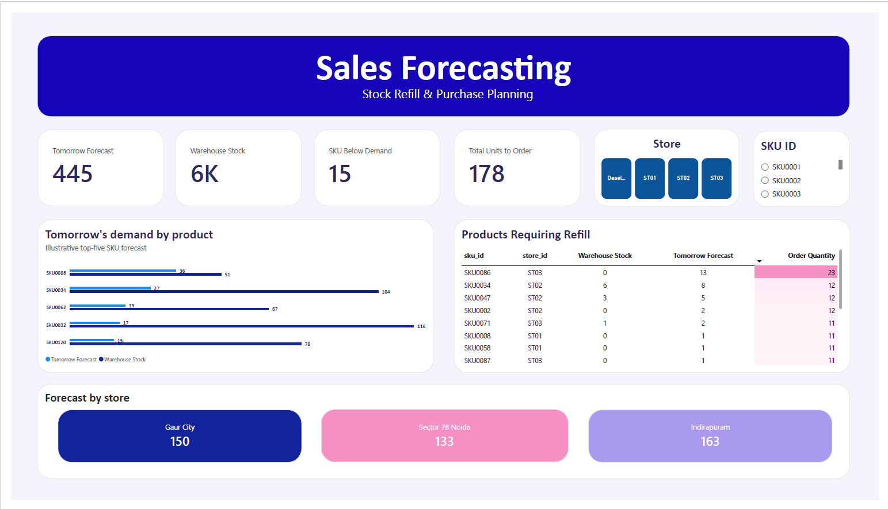

# 📊 Sales Forecasting & Inventory Optimization Dashboard

## 📌 Project Overview

An interactive **Power BI dashboard** designed to forecast product demand, monitor inventory availability, and optimize stock replenishment across three retail store locations: Gaur City, Sector 78 Noida, and Indirapuram.

The project covers **120 SKUs across 3 stores** and uses moving-average forecasting techniques to estimate next-day demand, identify potential stock shortages, and support data-driven purchasing decisions.

## 🖥️ Dashboard Preview

## 🎯 Project Objectives

- 📈 Forecast next-day product demand using historical sales trends.
- 📦 Compare forecasted demand against available inventory.
- ⚠️ Identify SKUs requiring replenishment to minimize potential stockouts.
- 🛒 Calculate recommended order quantities for inventory planning.
- 🏬 Monitor demand forecasts across multiple store locations.

## 🛠️ Tools & Technologies

- 📊 **Power BI** — Interactive dashboard and data visualization
- 🧮 **DAX** — Forecasting measures, inventory KPIs, and replenishment calculations
- 📑 **Excel** — Data preparation and analysis

## 🔍 Forecasting Methodology

Implemented two moving-average measures to estimate future demand:

- **7-Day Moving Average:** Captures recent sales trends and short-term demand fluctuations.
- **30-Day Moving Average:** Smooths daily variations and provides a more stable demand estimate.

The final forecast combines both moving averages to balance recent demand patterns with longer-term trends.

## ✨ Key Dashboard Features

### 📌 1. KPI Overview
Displays key inventory and forecasting indicators:
- Tomorrow's Forecast
- Warehouse Stock
- SKUs Below Demand
- Total Units to Order

### 📈 2. Demand vs. Inventory Analysis
Compares forecasted product demand with available stock to identify potential shortages and inventory risks.

### 🚨 3. Inventory Alerts & Replenishment Planning
Highlights SKUs requiring replenishment and displays warehouse stock, forecasted demand, and recommended order quantities.

### 🏬 4. Store-Level Demand Forecasting
Tracks forecasted demand across three retail locations:
- Gaur City (ST01)
- Sector 78 Noida (ST02)
- Indirapuram (ST03)

### 🎛️ 5. Interactive Filters
Enables users to filter dashboard insights by store and SKU for detailed inventory analysis and purchasing decisions.

## 📊 Key Insights

The dashboard screenshot displays the following metrics for the selected filters:

| 📌 Metric | 📈 Value |
|---|---:|
| Tomorrow's Forecast | 445 units |
| Warehouse Stock | 6K units |
| SKUs Below Demand | 15 |
| Total Units to Order | 178 units |
| Gaur City Forecast | 150 units |
| Sector 78 Noida Forecast | 133 units |
| Indirapuram Forecast | 163 units |

*Note: These values represent the dashboard snapshot and may vary with filters or changes to the underlying data.*

## 💼 Business Value

- ✅ Improves visibility into upcoming inventory requirements.
- ✅ Helps identify products at risk of stockouts.
- ✅ Supports store-level replenishment and purchasing
